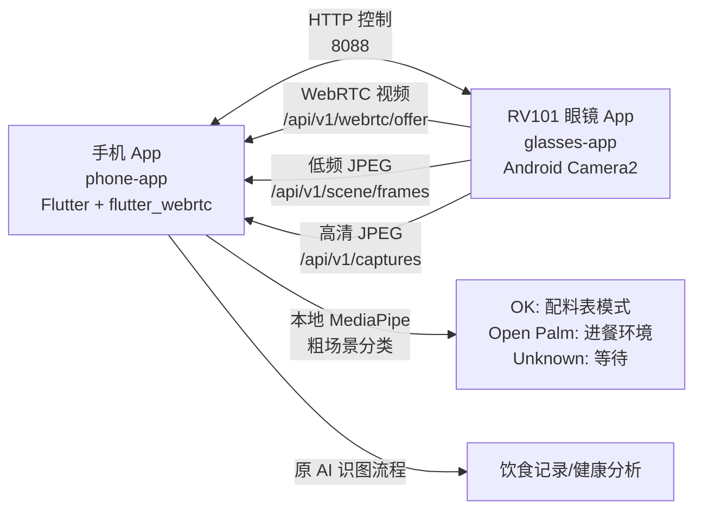

# AI 眼镜实时预览与手机端场景识别技术说明

> 面向对象：后续负责手机 App、RV101 眼镜端、AI 识别、OCR、营养计算和项目答辩材料的成员。
> 当前仓库：`worstwoof/AI-glasses`
> 当前结构：手机端 `phone-app/`，眼镜端 `glasses-app/`
> 最后更新：2026-08-09

## 1. 先读结论

本阶段已经把原来分散的手机端 Flutter App 和 RV101 眼镜端 Android 项目整理到同一个 `AI-glasses` 仓库中，并打通了“手机 App 直接连接眼镜”的局域网链路。

现在的主线方案是：

- 手机端打开健康管理 App，进入“识别 -> 实时预览”页。
- 手机端在局域网内监听 `8080` 端口，同时扫描同网段的 RV101。
- 眼镜端 App 常驻或待机监听 `8088` 控制端口。
- 手机端找到眼镜后，向眼镜发送上传地址和配对 token。
- 眼镜端使用 Camera2 采集预览帧，通过 WebRTC 推给手机端显示实时画面。
- 眼镜端每秒左右额外上报一张低清 JPEG 给手机端，手机端用 MediaPipe Hand Landmarker 做粗场景分类。
- 手机端按钮或后续场景触发可以让眼镜端抓拍高清 JPEG，继续走原来的 AI 食物识别和饮食记录写入逻辑。

当前不是公网直播方案，只面向同一 Wi-Fi 或手机热点局域网；不需要 TURN/STUN，也不依赖蓝牙传输视频。



## 2. 本阶段修改内容总览

### 2.1 仓库结构调整

原来手机 App 在仓库根目录，眼镜端项目在另一个本地目录。现在已经整理为单仓双项目：

```text
AI-glasses/
├─ README.md
├─ phone-app/      # Flutter 手机端 App
└─ glasses-app/    # RV101 眼镜端 Android App
```

对应职责：

| 目录 | 运行设备 | 主要职责 |
|---|---|---|
| `phone-app/` | Android 手机 | 页面展示、HTTP 接收服务、WebRTC answer、实时画面渲染、JPEG 抓拍接收、手机端粗场景分类、原 AI 识图和饮食记录 |
| `glasses-app/` | RV101 眼镜 | Camera2 取帧、WebRTC offer 和推流、低频分类帧上报、高清 JPEG 抓拍、HTTP 上传、眼镜端控制服务 |

同时补充了根目录和两个子项目的 README，并更新 `.gitignore`，避免把 `build/`、`.gradle/`、`.kotlin/`、APK、AAB、`local.properties`、截图和本地调试产物提交到 Git。

### 2.2 手机端新增和调整

手机端主要改动集中在：

```text
phone-app/
├─ lib/recognition_page_fast.dart
├─ lib/services/glass_receiver_service.dart
├─ lib/services/phone_scene_classifier.dart
├─ android/app/src/main/kotlin/com/aiglasses/nutrition/MainActivity.kt
├─ android/app/src/main/kotlin/com/aiglasses/nutrition/PhoneSceneClassifier.kt
└─ android/app/src/main/assets/hand_landmarker.task
```

已完成能力：

- 在“识别”页增加“实时预览 / 单张识图”双模式入口。
- 实时预览页启动后，手机端监听 `8080`，显示上传地址、WebRTC 信令地址和配对 token。
- 手机端自动扫描本机局域网 IP 所在网段，尝试连接 RV101 的 `8088` 控制端口。
- 手机端向眼镜发送启动请求，携带 `uploadEndpoint` 和 `token`，让眼镜不用每次依赖电脑终端手工启动采集链路。
- 手机端接收眼镜发来的 WebRTC offer，生成 answer，返回给眼镜端。
- 手机端使用 `RTCVideoRenderer` 渲染远端视频轨道。
- 手机端通过 WebRTC data channel 向眼镜发送 `{ "type": "capture" }`，触发高清抓拍。
- 手机端继续保留 `POST /api/v1/captures`，接收眼镜上传的 JPEG，并接到原来的 AI 食物识别/饮食记录流程。
- 手机端新增 `POST /api/v1/scene/frames`，接收低频预览 JPEG，在手机 APK 内运行 MediaPipe Hand Landmarker。
- 手机端把 OK 手势识别为 `ingredient_label`，把张开手掌识别为 `eating`，其他画面识别为 `unknown`。

### 2.3 眼镜端新增和调整

眼镜端主要改动集中在：

```text
glasses-app/app/src/main/java/com/example/rv101cameraprobe/
├─ MainActivity.kt
├─ CaptureService.kt
├─ CameraCaptureController.kt
├─ GlassesControlServer.kt
├─ WebRtcPreviewPublisher.kt
├─ PreviewFrameReporter.kt
├─ PhotoUploader.kt
├─ UploadConfiguration.kt
├─ VoiceAnnouncer.kt
└─ YuvFrameConverter.kt
```

已完成能力：

- 眼镜端 App 保留 Camera2 前台采集服务。
- 新增 `GlassesControlServer`，监听 `8088`，让手机端可以通过局域网请求眼镜开始采集。
- 眼镜端保存手机端下发的上传地址和 token。
- 眼镜端从上传地址自动推导：
  - WebRTC 信令地址：`/api/v1/webrtc/offer`
  - 场景帧上报地址：`/api/v1/scene/frames`
- 眼镜端使用同一路 `YUV_420_888` Camera2 预览帧：
  - 转成 I420 后送 WebRTC 视频流；
  - 低频压缩成 JPEG 后上传给手机端场景分类；
  - 需要抓拍时请求高清 JPEG。
- 眼镜端不再运行旧的水果识别模型，也不再在眼镜端跑手势/食品分类模型。
- 高清抓拍和上传逻辑保留，失败时保留本地照片并提示。
- 保留固定语音提示，如手机端请求拍照、上传成功、上传失败。

### 2.4 被刻意保留的边界

- 不做公网直播。
- 不配置 TURN/STUN。
- 不走蓝牙传视频或图片。
- 眼镜端不做 AI 食物识别、OCR、热量计算。
- 手机端当前只做粗场景分类提示，不自动写入正式饮食记录。
- 高风险的饮食记录写入仍建议保留用户确认步骤，避免误拍、误识别污染健康档案。

## 3. 总体技术路线

### 3.1 为什么是“手机主控 + 眼镜采集”

最开始的问题是：用户希望只打开手机 App，就能在手机 App 里直接连接眼镜，而不是每次通过电脑 ADB 中转启动眼镜程序。

因此本阶段采用“手机主控”的路线：

1. 手机 App 是用户入口。
2. 眼镜 App 是局域网采集终端。
3. 手机 App 启动后自动发现眼镜。
4. 手机 App 把本机接收地址和 token 下发给眼镜。
5. 眼镜拿到配置后自己发起 WebRTC offer、分类帧上报和 JPEG 上传。

这样做的好处是：

- 用户演示路径更短，只需要打开手机 App 的实时预览页。
- 手机端可以统一控制“预览、抓拍、AI 分析、饮食记录”。
- 眼镜端保持轻量，只管采集和传输。
- 场景识别模型放手机端，后续替换模型更方便，不受 RV101 性能和模型部署限制。

### 3.2 为什么不用蓝牙传实时画面

蓝牙可以用于设备发现、配对、低频控制命令，但不适合承载实时视频或高清 JPEG 上传：

- 蓝牙带宽远低于 Wi-Fi，实时画面延迟和码率都不够稳定。
- 高清 JPEG 抓拍可能达到数 MB，蓝牙传输体验会很差。
- 当前 Rokid AI 的蓝牙连接属于官方设备管理链路，自制 App 不应强行替代官方配对、设置和 OTA。

所以当前方案是：Rokid AI 仍可负责官方蓝牙配对和设备管理，自制实时预览链路走同一 Wi-Fi 或手机热点。

### 3.3 为什么 WebRTC 只做局域网

WebRTC 的优势是低延迟视频传输和成熟的视频编码/解码链路。当前目标只是让手机和眼镜在同一局域网里实时预览，不需要公网直播，因此：

- 不配置 TURN；
- 不配置 STUN；
- 只使用本机局域网 ICE candidate；
- 必要时根据手机热点或同网段前缀过滤 SDP candidate，减少连到错误网卡的概率。

这样实现简单、延迟低，也避免公网服务和账号成本。

## 4. 手机端实现细节

### 4.1 `GlassReceiverService`

`phone-app/lib/services/glass_receiver_service.dart` 是手机端接收和控制链路的核心。

它负责：

- 监听本地 HTTP 服务；
- 管理配对 token；
- 计算当前手机局域网 IP；
- 生成上传地址和 WebRTC 信令地址；
- 扫描局域网内的 RV101 控制端口；
- 请求眼镜启动采集；
- 接收 WebRTC offer 并返回 answer；
- 接收远端视频流并通知页面渲染；
- 接收高清 JPEG；
- 接收低频场景帧；
- 调用手机端场景分类器；
- 通过 data channel 给眼镜发送抓拍命令。

关键常量：

```dart
static const int defaultPort = 8080;
static const String defaultPairingToken = 'CsF8V6pEOWqlfcktClawh60N';
static const _capturePath = '/api/v1/captures';
static const _offerPath = '/api/v1/webrtc/offer';
static const _sceneFramePath = '/api/v1/scene/frames';
static const _glassesStartPath = '/api/v1/glasses/start';
static const _glassesControlPort = 8088;
static const _maxImageBytes = 20 * 1024 * 1024;
static const _maxSceneFrameBytes = 2 * 1024 * 1024;
```

### 4.2 手机端 HTTP 接口

手机端监听 `8080` 后，提供三个主接口。

#### 4.2.1 高清抓拍上传

```text
POST http://<手机IP>:8080/api/v1/captures
X-Device-Token: <配对token>
Content-Type: multipart/form-data

image: JPEG
metadata: JSON
```

用途：

- 眼镜端抓拍高清 JPEG 后上传；
- 手机端保存图片和 metadata；
- 后续继续接原 AI 食物识别和饮食记录流程。

当前限制：

- 单张 JPEG 最大 `20 MB`。
- `X-Device-Token` 必须匹配手机端 token。
- 不应把 token、真实用户图片或上传结果提交到 Git。

#### 4.2.2 WebRTC offer 信令

```text
POST http://<手机IP>:8080/api/v1/webrtc/offer
X-Device-Token: <配对token>
Content-Type: application/json

{
  "type": "offer",
  "sdp": "...",
  "candidates": [
    {
      "candidate": "...",
      "sdpMid": "0",
      "sdpMLineIndex": 0
    }
  ]
}
```

手机端返回：

```json
{
  "accepted": true,
  "type": "answer",
  "sdp": "...",
  "candidates": []
}
```

这一步完成后，手机端等待 ICE 连通并渲染远端视频轨道。

#### 4.2.3 低频场景帧

```text
POST http://<手机IP>:8080/api/v1/scene/frames
X-Device-Token: <配对token>
Content-Type: multipart/form-data

image: scene-frame.jpg
```

用途：

- 眼镜端不做模型推理，只把低清 JPEG 传过来；
- 手机端用本地 MediaPipe 模型判断 OK 手势、张开手掌或未知；
- 页面展示当前粗场景状态。

### 4.3 手机端自动发现眼镜

手机端进入实时预览页后，会读取本机 IPv4 地址，并按局域网前缀构造候选 IP。

典型情况：

- 手机热点：手机常见 IP 为 `192.168.43.1`。
- 眼镜连入热点后通常获得同网段地址，如 `192.168.43.x`。
- 普通路由器 Wi-Fi 下，手机和眼镜可能是 `192.168.1.x`、`192.168.31.x` 等。

手机端会向候选地址的 `8088` 端口发送控制请求。找到可达眼镜后，会缓存上一次眼镜 IP，以便下次优先连接。

### 4.4 手机端粗场景分类

场景分类由两部分组成：

```text
phone-app/lib/services/phone_scene_classifier.dart
phone-app/android/app/src/main/kotlin/com/aiglasses/nutrition/PhoneSceneClassifier.kt
```

Dart 层通过 MethodChannel 调 Android 原生层：

```dart
static const MethodChannel _channel = MethodChannel(
  'com.aiglasses.nutrition/scene_classifier',
);
```

Android 原生层加载：

```text
phone-app/android/app/src/main/assets/hand_landmarker.task
```

分类规则：

| 输入画面 | 输出 scene | 页面含义 | 当前后续动作 |
|---|---|---|---|
| OK 手势 | `ingredient_label` | 配料表识别模式 | 先作为 OCR 准备状态 |
| 张开手掌、手心对摄像头 | `eating` | 进餐环境 | 先作为无感记录准备状态 |
| 未识别到手势 | `unknown` | 等待场景手势 | 不触发分析 |

为了减少误触发，手机端会要求连续命中后才切换粗场景状态。当前阶段只做“状态分类和页面提示”，不会自动 OCR、自动算热量或直接写入饮食记录。

### 4.5 手机端实时预览页面

实时预览页属于 `phone-app/lib/recognition_page_fast.dart` 中的识别流程。

页面上需要关注的状态包括：

- 手机是否正在监听 `8080`；
- 当前手机局域网 IP；
- 上传地址；
- WebRTC 信令地址；
- 配对 token；
- 是否找到 RV101；
- WebRTC 视频是否连接；
- ICE 状态；
- data channel 是否可用于抓拍；
- 当前粗场景分类；
- 最近一张抓拍图片。

用户点击“眼镜抓拍”后，手机端会通过 data channel 发送：

```json
{
  "type": "capture",
  "trigger": "app_button",
  "timestamp": 1760000000000
}
```

眼镜端收到后执行高清 JPEG 抓拍并上传到 `/api/v1/captures`。

## 5. 眼镜端实现细节

### 5.1 `CaptureService`

`glasses-app/app/src/main/java/com/example/rv101cameraprobe/CaptureService.kt` 是眼镜端主服务。

它负责：

- 启动前台服务；
- 管理相机采集生命周期；
- 启动 `GlassesControlServer`；
- 启动 `WebRtcPreviewPublisher`；
- 启动 `PreviewFrameReporter`；
- 处理手机端抓拍请求；
- 调用 `PhotoUploader` 上传高清 JPEG；
- 维护状态机和页面/通知状态；
- 持有 `PARTIAL_WAKE_LOCK`，降低采集中断概率。

眼镜端状态大致为：

```text
STOPPED / STANDBY
  -> STARTING
  -> DETECTING
  -> CAPTURING
  -> COOLDOWN
  -> ERROR
```

其中 `DETECTING` 在当前版本并不是眼镜端 AI 检测，而是表示 Camera2 预览持续运行，场景分类交给手机端。

### 5.2 `GlassesControlServer`

`GlassesControlServer` 是为了实现“手机 App 直接连接眼镜”新增的局域网控制服务。

监听端口：

```text
8088
```

接口：

```text
GET http://<眼镜IP>:8088/api/v1/glasses/status
```

返回眼镜当前状态，用于手机端发现和健康检查。

```text
POST http://<眼镜IP>:8088/api/v1/glasses/start
X-Device-Token: <配对token>
Content-Type: application/json

{
  "uploadEndpoint": "http://<手机IP>:8080/api/v1/captures",
  "token": "<配对token>"
}
```

处理逻辑：

- 校验 `X-Device-Token` 是否等于眼镜端已保存 token；
- 如果请求体带了新的 `uploadEndpoint` 和 `token`，则保存配置；
- 如果采集服务未运行，则启动 Camera2 + WebRTC + 分类帧上报；
- 如果采集服务已经运行，则重启 WebRTC 预览发布器，让手机端重新建链。

注意：首次安装、眼镜完整重启或系统杀掉进程后，RV101 固件可能拦截第三方 App 的冷启动广播。此时仍需要先在眼镜上打开一次 `RV101 Camera Probe`，让控制服务进入待机；之后手机 App 就可以直接连接。

### 5.3 `CameraCaptureController`

`CameraCaptureController` 负责 Camera2 相机。

当前策略：

- 预览帧使用 `640x480` 的 `YUV_420_888`；
- 同一路预览帧同时供 WebRTC 和低频场景帧使用；
- 抓拍时优先请求高分辨率 JPEG；
- 如果高清抓拍失败或超时，保留预览帧降级兜底；
- 如果相机被 Rokid 系统或其他服务占用，进入 busy 状态并退避重试。

这样可以避免为了预览、分类、拍照各开一路相机造成冲突。

### 5.4 `WebRtcPreviewPublisher`

`WebRtcPreviewPublisher` 负责眼镜端 WebRTC 推流。

工作流程：

1. 根据上传地址推导信令地址：

   ```text
   http://<手机IP>:8080/api/v1/webrtc/offer
   ```

2. 创建本地 PeerConnection。
3. 创建视频轨道。
4. 创建 data channel，label 为 `rv101-control`。
5. 从 Camera2 获取 I420 frame 后送入 WebRTC。
6. 创建 offer 并收集本地 ICE candidate。
7. 通过 HTTP POST 把 offer 发给手机端。
8. 设置手机端返回的 answer。
9. 监听 data channel 消息；收到 `type=capture` 后回调 `CaptureService` 执行抓拍。

当前不配置 STUN/TURN，只依赖局域网 candidate。

### 5.5 `PreviewFrameReporter`

`PreviewFrameReporter` 负责低频场景帧上报。

工作流程：

1. 从同一路 Camera2 预览帧取图。
2. 降低频率，避免占用过多带宽和手机端推理资源。
3. 将图像压缩成低质量 JPEG。
4. POST 到手机端：

   ```text
   http://<手机IP>:8080/api/v1/scene/frames
   ```

5. 手机端分类后更新页面状态。

这一步的设计核心是“模型放手机端，眼镜端只传轻量图片”。这样后续模型升级主要改手机端 APK，不需要在 RV101 上部署复杂模型。

### 5.6 `PhotoUploader`

`PhotoUploader` 负责高清抓拍上传。

上传地址来自手机端：

```text
http://<手机IP>:8080/api/v1/captures
```

请求格式：

```text
multipart/form-data
image: JPEG
metadata: JSON
```

metadata 当前包含：

```json
{
  "deviceId": "RV101",
  "timestamp": 1760000000000,
  "trigger": "app_button",
  "scene": "remote_preview",
  "sceneConfidence": 0.0,
  "width": 4032,
  "height": 3024
}
```

当前 `trigger` 主要有：

- `app_button`：手机实时预览页按钮触发。
- `manual`：眼镜端本地或调试触发。

后续可扩展：

- `scene_ingredient_label`：OK 手势进入配料表模式后触发。
- `scene_eating`：张开手掌进入进餐环境后触发。
- `gesture`：眼镜端独立手势触发，当前不作为主线。

## 6. 完整运行流程

### 6.1 日常演示路径

1. 手机和 RV101 连接到同一个 Wi-Fi，或手机开热点并让眼镜连接该热点。
2. 打开眼镜端 `RV101 Camera Probe` 一次，确保它能进入待机或采集状态。
3. 打开手机端 `AI Glasses Nutrition App`。
4. 进入底部中间“识别”入口。
5. 切到“实时预览”。
6. 手机端启动 `8080` 接收服务并显示地址/token。
7. 手机端自动搜索 RV101。
8. 找到眼镜后，手机端请求 `8088 /api/v1/glasses/start`。
9. 眼镜端启动 Camera2、WebRTC、低频分类帧上报。
10. 手机端显示实时预览画面。
11. 对着眼镜摄像头做 OK 或张开手掌，手机端显示粗场景状态。
12. 点击手机端“眼镜抓拍”，眼镜端拍高清 JPEG 并上传。
13. 手机端收到图片后继续原 AI 识图和饮食记录流程。

### 6.2 当前仍需要手动打开眼镜 App 的情况

以下情况通常需要先在眼镜上打开一次 `RV101 Camera Probe`：

- 眼镜完整重启；
- 刚重新安装眼镜端 APK；
- 系统杀掉了眼镜端进程；
- RV101 固件拦截第三方冷启动广播。

打开一次后，后续连接和启动可以由手机端完成，不需要每次通过电脑终端中转。

## 7. 构建、安装和调试

### 7.1 构建手机端

```powershell
cd D:\大创\AI-glasses\phone-app
F:\Environment\flutter\bin\flutter.bat pub get
F:\Environment\flutter\bin\flutter.bat build apk --debug
```

产物：

```text
D:\大创\AI-glasses\phone-app\build\app\outputs\flutter-apk\app-debug.apk
```

### 7.2 构建眼镜端

```powershell
cd D:\大创\AI-glasses\glasses-app
.\gradlew.bat :app:assembleDebug --console=plain
```

产物：

```text
D:\大创\AI-glasses\glasses-app\app\build\outputs\apk\debug\app-debug.apk
```

### 7.3 安装 APK

安装时必须显式指定设备号，避免把眼镜 APK 装到手机上，或把手机 APK 装到眼镜上。

```powershell
$adb = "<Android SDK>\platform-tools\adb.exe"

# 手机端
& $adb -s <手机设备号> install -r "D:\大创\AI-glasses\phone-app\build\app\outputs\flutter-apk\app-debug.apk"

# 眼镜端
& $adb -s <RV101设备号> install -r "D:\大创\AI-glasses\glasses-app\app\build\outputs\apk\debug\app-debug.apk"
```

### 7.4 首次或排障时手动启动眼镜端

日常演示优先从手机 App 连接。仅在首次安装、眼镜重启、排障时使用 ADB。

```powershell
$adb = "<Android SDK>\platform-tools\adb.exe"
$glass = "<RV101设备号>"

& $adb -s $glass shell am start -n "com.example.rv101cameraprobe/.MainActivity"
```

如果需要直接写入手机地址和 token：

```powershell
& $adb -s $glass shell am start -n "com.example.rv101cameraprobe/.MainActivity" `
  --es upload_endpoint "http://<手机IP>:8080/api/v1/captures" `
  --es upload_token "<配对token>" `
  --ez start_capture true
```

PowerShell 注意事项：尖括号只是占位符，实际执行时必须替换掉，不能保留 `<手机IP>`、`<配对token>` 这种写法。

### 7.5 常用日志

查看眼镜端进程日志：

```powershell
$adb = "<Android SDK>\platform-tools\adb.exe"
$glass = "<RV101设备号>"
$pid = (& $adb -s $glass shell pidof com.example.rv101cameraprobe).Trim()

& $adb -s $glass logcat -d -v threadtime --pid $pid |
  Select-String -Pattern "GlassesControlServer|CaptureService|Camera ready|CAMERA_BUSY|WebRTC|PreviewFrameReporter|Photo uploaded|Upload failed|fallback"
```

查看手机端 Flutter 日志时同样必须指定设备：

```powershell
$phone = "<手机设备号>"
& $adb -s $phone logcat -d -v threadtime |
  Select-String -Pattern "GlassReceiver|WebRTC|scene_classifier|flutter"
```

## 8. 当前验证结果

本阶段已经完成的本地验证：

- 手机端工程在 `phone-app/` 下可构建 debug APK。
- 眼镜端工程在 `glasses-app/` 下可构建 debug APK。
- 手机端实时预览曾在实机上显示 RV101 画面。
- 手机端可以在实时预览页触发眼镜端高清抓拍。
- 眼镜端 JPEG 上传仍走 `/api/v1/captures`。
- 手机端低频场景帧接口和 MediaPipe 手势粗分类已接入。
- 旧的眼镜端水果识别路线已经从主链路移除。
- 最新代码已整理到 GitHub 仓库分支并创建 PR，便于合入主分支。

构建命令：

```powershell
# phone-app
F:\Environment\flutter\bin\flutter.bat build apk --debug

# glasses-app
.\gradlew.bat :app:assembleDebug --console=plain
```

Git 检查：

```text
未提交 build/、.gradle/、.kotlin/、local.properties、APK/AAB、截图和本地调试产物。
```

## 9. 常见问题和处理

| 现象 | 可能原因 | 处理方式 |
|---|---|---|
| 手机实时预览页找不到眼镜 | 不在同一 Wi-Fi/热点；眼镜端 App 未运行；`8088` 控制服务未启动 | 先确认网络，再在眼镜上打开一次 `RV101 Camera Probe` |
| 手机显示监听地址不是 `192.168.43.1` | 当前不是手机热点，或系统分配了其他网段 | 以手机 App 页面显示的实际地址为准 |
| WebRTC offer 成功但没有画面 | ICE candidate 选错网卡、眼镜相机未启动、WebRTC 连接中断 | 重新点连接眼镜，确认同网段，查看 WebRTC 和 Camera2 日志 |
| 眼镜显示相机忙 | Rokid 系统或官方功能占用摄像头 | 退出官方拍照/录像，等待眼镜端自动重试 |
| 点击抓拍没有反应 | data channel 未打开 | 等页面显示“控制 可抓拍”后再点击 |
| 上传返回 401 | 手机和眼镜 token 不一致 | 在手机端重置/显示 token，再重新连接眼镜 |
| 收到图片但不是高清 | 高清 JPEG 抓拍失败，走预览帧兜底 | 查眼镜端 `fallback`、`captureStill`、Camera2 日志 |
| 场景分类不稳定 | 低频帧画面太暗、手势太近/太远、手不完整 | 调整手势距离和光照；后续可提升模型和规则 |
| 完整重启后手机不能直接唤起眼镜 | RV101 固件限制第三方 App 冷启动 | 先在眼镜上打开一次采集 App |

## 10. 后续技术路线

### 10.1 场景识别从“粗分类”升级到“任务路由”

当前只有：

- OK -> 配料表识别准备；
- 张开手掌 -> 进餐环境准备；
- unknown -> 等待。

后续可以扩展为：

```text
scene = ingredient_label
  -> 抓拍包装/配料表
  -> OCR
  -> 配料表结构化
  -> 营养成分表解析
  -> 过敏原/高糖高脂高钠风险提示

scene = eating
  -> 抓拍餐食
  -> 食物识别
  -> 份量估计
  -> 热量和三大营养素计算
  -> 用户确认
  -> 写入饮食记录
```

建议仍然保留“用户确认”步骤，不要直接把模型输出写入长期健康档案。

### 10.2 手机端模型升级方向

当前 `hand_landmarker.task` 只用于手部关键点，OK 和张开手掌由规则判断。后续可以有两条路线：

1. 继续使用 MediaPipe 手部关键点，优化规则和稳定性。
2. 增加手机端轻量场景分类模型，识别“餐盘、包装食品、饮料、无效画面”等更丰富场景。

推荐先走第一条，因为稳定、部署简单、可解释；等数据积累后再训练第二阶段场景模型。

### 10.3 上传可靠性

当前上传失败时会保留照片，但还不是完整离线队列。后续应补：

- 每张抓拍生成 `captureId`；
- 眼镜端持久化待上传队列；
- 网络恢复后自动重试；
- 手机端按 `captureId` 去重；
- 上传状态可在手机和眼镜两端查看。

### 10.4 与后端和健康记录的正式闭环

建议后端任务状态：

```text
RECEIVED
  -> UPLOADING
  -> ANALYZING
  -> NEED_CONFIRMATION
  -> CONFIRMED
  -> FAILED
```

原则：

- 手机收到眼镜 JPEG 后先创建采集任务；
- AI 分析结果先展示给用户；
- 用户确认后才写入饮食记录；
- 配料表/OCR 结果可以进入食品详情或风险提示，不默认等价于“用户已摄入”。

## 11. 协作要求

- ADB 命令必须带 `-s` 指定设备。
- 不提交真实用户图片、热点密码、API Key、局域网 token、`local.properties`、APK、build 输出。
- 修改接口后同步更新本文档。
- 修改手机端场景分类规则后，同步记录场景枚举、阈值和触发条件。
- 修改眼镜端相机链路后，必须回归实时预览、低频分类帧、高清抓拍三条链路。
- 修改 WebRTC 链路后，至少在手机热点和普通 Wi-Fi 两种网络下各测一次。

## 12. 一句话版本

这次改造的核心是：把 AI 模型和用户交互收回到手机端，把 RV101 眼镜端降为稳定的 Camera2 采集和传输终端；手机 App 负责发现眼镜、建立 WebRTC 实时预览、接收高清抓拍、做粗场景分类，并继续接原来的 AI 食物识别和饮食记录流程。
