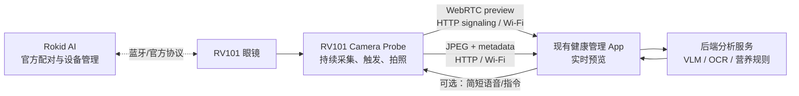

# AI 眼镜采集与手机 App 衔接说明

> 面向对象：后续负责健康管理 App、后端接口、食品识别或 OCR 的项目成员。
> 仓库：[WendyAr9944/rv101-food-capture](https://github.com/WendyAr9944/rv101-food-capture)
> 最后更新：2026-07-28

## 1. 先读结论

本项目不需要再做一个新的健康管理手机 App。现有健康管理 App 是最终面向用户的手机端；当前仓库中的 `food-phone-receiver` 是已经验证可用的“眼镜图片接收原型”，后续应作为模块合入现有健康管理 App。

当前采用双 App 方案：

- **Rokid AI**：保留作为官方设备管理 App，负责眼镜日常配对、基础设置、官方相册和官方 AI 功能。
- **自制眼镜采集 App**：安装在 RV101 眼镜端，负责持续取帧、WebRTC 实时预览推流、手势/场景触发、高分辨率拍照及图片上传。
- **自制食品健康 App**：安装在手机端，负责接收眼镜实时预览、接收眼镜 JPEG 抓拍、调用现有图片分析/后端、写入饮食记录，并利用已有的首页、日历、健康分析、档案页面展示结果。手机端现在可以直接在“识别 → 实时预览”页发起连接。

当前图片传输**不走蓝牙**。Rokid AI 的蓝牙连接与自制采集链路可并行存在；图片通过手机热点或同一 Wi-Fi 的 HTTP 局域网传输。



## 2. 当前已完成能力

### 2.1 眼镜端

模块目录：`rv101-camera-probe`
Android 包名：`com.example.rv101cameraprobe`

- 已通过开发线和 ADB 连接 RV101，能够安装、启动和调试自制眼镜端 APK。
- 使用 Camera2 持续获取 `640x480` 的 `YUV_420_888` 帧，作为 WebRTC 预览和手机端粗场景分类输入。
- 同一路 Camera2 预览帧会额外复制为 I420，通过 WebRTC 推送到手机端；不会打开第二路相机。
- 同一路预览帧约每秒压缩一张低质量 JPEG，上传到手机 `/api/v1/scene/frames`，眼镜端不做分类。
- 通过前台服务和 `PARTIAL_WAKE_LOCK` 保持采集；相机暂时被系统服务占用时会进入 `CAMERA_BUSY` 并按 `1/2/4/8/15/30` 秒退避重试。
- 旧的眼镜端 MediaPipe 手势模型和四类水果 ONNX 模型已移除；粗场景分类改由手机 APK 内的 MediaPipe 执行。
- 拍照优先请求 `4032x3024` JPEG；若眼镜相机不支持或拍照超时，会降级保存 `640x480` 预览帧。**高分辨率实机链路仍应以手机端收到图片的实际尺寸为准进行回归测试。**
- 手机端实时预览页的“眼镜抓拍”按钮会通过 WebRTC data channel 回到眼镜端，继续复用原高分辨率 JPEG 抓拍和 HTTP 上传链路。
- 已提供固定语音提示音：手机请求拍照、上传成功/失败等。当前眼镜系统原生动态 TTS 不可用，动态分析结果播报应在后续由手机/后端生成音频后再下发。

### 2.2 手机端健康 App

模块目录：外部 Flutter 项目 `AI-glasses`
Android 包名：`com.aiglasses.nutrition`

- 打开识别页后，Flutter 端监听 TCP `8080` 端口。
- `POST /api/v1/webrtc/offer` 接收眼镜端 WebRTC offer，返回 answer，并用 `RTCVideoRenderer` 显示远端视频轨道。
- `POST /api/v1/captures` 接收、校验并保存眼镜上传的 JPEG 和元数据，图片保存在 App 私有目录。
- 识别页提供“实时预览 / 单张识图”双模式入口，实时预览用于取景，单张识图继续调用现有 AI 视觉接口。
- `POST /api/v1/scene/frames` 接收眼镜低频 JPEG，在手机 Android 原生层运行 MediaPipe Hand Landmarker。
- 连续两帧 OK 手势切换为配料表识别准备状态；连续两帧张开手掌切换为进餐环境准备状态。
- 收到眼镜 JPEG 后可直接进入原 AI 分析流程，确认后写回今日饮食记录。
- 单张 JPEG 上限为 `20 MB`，足以承接当前 `4032x3024` 拍照目标。

`food-phone-receiver` 仍保留为 Android 原生接收原型，可用于回归测试上传协议，但不再是最终用户演示的手机端入口。

### 2.3 尚未完成或不能视为产品能力的内容

- 目前的手机接收与实时预览能力已经在 `AI-glasses` Flutter App 中打通；`food-phone-receiver` 仅作为早期原型和回归参考保留。
- 收到图片后尚未自动调用食品识别、份量估计、包装 OCR、营养分析或用户档案规则。
- 上传失败时眼镜端会保留照片并提示失败，但尚未完成持久化上传队列和网络恢复后自动重试。
- 当前只实现 OK/张开手掌/未知三类粗分类，尚未自动调用 OCR、热量计算或无感写入饮食记录。
- 尚未以 Rokid Phone SDK 自研蓝牙设备管理。因此不能替代 Rokid AI 的配对、设置、OTA 等官方功能。

## 3. 三个 App 的职责与使用边界

| 组件 | 运行位置 | 当前职责 | 不负责的事情 |
|---|---|---|---|
| Rokid AI | 手机 | 眼镜配对、基础设置、官方相册、官方 AI | 不接收本项目的 HTTP 图片，不写入本项目饮食记录 |
| RV101 Camera Probe | 眼镜 | 取帧、WebRTC、低频分类帧上报、高清拍照、上传 | 不做手势/食品分类、OCR、营养计算 |
| FoodPhoneReceiver | 手机 | 局域网图片接收、保存、展示 | 不做最终后端分析，后续将被合入健康管理 App |
| 现有健康管理 App | 手机 | 用户档案、饮食记录、日历、健康分析、结果展示 | 当前尚未接入眼镜图片 |
| 后端服务 | 云端或局域网服务器 | VLM、OCR、营养计算、风险规则、建议 | 不直接控制眼镜硬件 |

注意：如果 Rokid AI 正在拍照、录像或调用相机，眼镜端采集 App 可能暂时无法打开摄像头。此时不要强行结束系统服务，等待自制 App 的自动重试，或先停止官方相机相关功能后再启动采集。

## 4. 日常演示和测试操作

### 4.1 准备网络

1. 在手机开启热点，或让手机与眼镜加入同一 Wi-Fi。
2. 眼镜和手机必须在同一局域网；手机热点场景通常手机地址为 `192.168.43.1`，但必须以手机 App 页面实际显示的地址为准。
3. 不要将热点地址、配对令牌或用户照片提交到 Git 仓库。

### 4.2 使用 Rokid AI

1. 正常打开 Rokid AI，按官方流程连接眼镜。
2. 需要调整官方设备设置时在 Rokid AI 中操作。
3. 演示自制采集功能前，避免在 Rokid AI 内同时进行拍照或录像，以免争抢相机。

### 4.3 启动手机接收端

1. 打开手机上的 Flutter 健康管理 App。
2. 进入中间的“识别”页，切到“实时预览”。
3. 页面会自动搜索同一局域网内的 RV101，并向眼镜发送启动指令。
4. 连接成功后，页面会显示“视频已连接”“局域网路径已连通”“控制 可抓拍”。
5. 只有在眼镜完整重启、App 被系统杀掉、或刚重新安装后，才需要先在眼镜上打开一次采集 App，再回到手机端连接。

### 4.4 配置并启动眼镜端采集

日常使用时不需要再手工通过 ADB 启动。眼镜端会在手机端连接后自动接收上传地址和令牌，并从上传地址推导 WebRTC 信令地址 `/api/v1/webrtc/offer`。

PowerShell 示例，其中尖括号内容必须替换为真实值，且**不要保留尖括号**：

```powershell
$adb = "C:\Users\Lenovo\AppData\Local\Android\Sdk\platform-tools\adb.exe"
$glass = "<RV101设备序列号>"

& $adb -s $glass shell am start -n "com.example.rv101cameraprobe/.MainActivity" `
  --es upload_endpoint "http://<手机页面IP>:8080/api/v1/captures" `
  --es upload_token "<手机页面配对令牌>" `
  --ez start_capture true
```

说明：PowerShell 中把 `<手机页面配对令牌>` 原样粘贴会被解释为重定向符号并报错；必须替换为实际令牌字符串，例如 `--es upload_token "abc..."`。

仅在排障、首次验证或眼镜重启后需要手动启动时，才使用下面的命令：

```powershell
& $adb -s $glass shell am start -n "com.example.rv101cameraprobe/.MainActivity" --ez start_capture true
```

也可在眼镜端 App 前台点击 **Start capture**。首次运行时必须允许相机权限。

### 4.5 验证一次完整上传

1. 确认手机端显示“正在监听 8080 端口”。
2. 佩戴眼镜，将食品或包装放入视野。
3. 在手机实时预览页对镜头做 OK 手势或张开手掌，观察粗场景状态是否切换。
4. 点击手机端“眼镜抓拍”，等待眼镜端保存并上传高清 JPEG。
5. 手机端应立即出现最新图片；打开详情页检查触发方式、尺寸和方向。
6. 用包装文字测试时，优先确认尺寸为 `4032x3024` 或旋转后的 `3024x4032`。若为 `640x480`，说明相机走了预览帧降级路径，需保留日志并排查。

## 5. 当前局域网上传协议

### 5.1 请求

```text
POST http://<手机IP>:8080/api/v1/captures
X-Device-Token: <手机端显示的配对令牌>
Content-Type: multipart/form-data

image: JPEG 文件
metadata: JSON 字符串
```

当前 `metadata` 必填字段：

```json
{
  "deviceId": "RV101",
  "timestamp": 1760000000000,
  "trigger": "gesture",
  "scene": "unknown",
  "sceneConfidence": 0.0,
  "width": 4032,
  "height": 3024
}
```

字段约定：

- `trigger`：当前主要取 `app_button` 或 `manual`；后续手机端自动记录可增加新的场景触发值。
- `scene`：眼镜端轻量模型初筛结果。它不是手机端或云端最终食品识别结论。
- `sceneConfidence`：范围 `0.0` 到 `1.0`。
- `timestamp`：Unix 毫秒时间戳。
- 单张 JPEG 最大 `20 MB`。

### 5.2 成功响应

```json
{
  "accepted": true,
  "captureId": "generated-id",
  "status": "received"
}
```

### 5.3 WebRTC 信令

```text
POST http://<手机IP>:8080/api/v1/webrtc/offer
X-Device-Token: <手机端显示的配对令牌>
Content-Type: application/json

{ "type": "offer", "sdp": "..." }
```

手机端返回：

```json
{ "accepted": true, "type": "answer", "sdp": "..." }
```

手机和眼镜仍必须在同一局域网内；本版本不配置 TURN / STUN。

常见错误码：

| HTTP 状态码 | 含义 |
|---|---|
| `201` | 手机已接收并保存图片 |
| `400` | 元数据、图片格式或字段无效 |
| `401` | `X-Device-Token` 不匹配 |
| `413` | 图片超过 20 MB |
| `404` | 请求路径错误 |

## 6. 与现有健康管理 App 的合入方案

### 6.1 总原则

将 `food-phone-receiver` 的本地接收能力迁入现有健康管理 App，不要让用户长期维护两个自制手机 App。迁入后，原健康 App 的“相机”页面应同时支持：

- 手机手动拍照/上传；
- 眼镜实时接收；
- 待分析图片确认；
- 食物记录或包装分析结果查看。

### 6.2 推荐数据状态

收到眼镜图片后，不要立刻写入正式饮食记录。应先创建一条采集任务：

```text
RECEIVED -> UPLOADING -> ANALYZING -> NEED_CONFIRMATION -> CONFIRMED
                                             |-> FAILED
```

- `RECEIVED`：手机已保存原图与采集元数据。
- `UPLOADING`：手机正在向后端上传。
- `ANALYZING`：后端正在执行 VLM、OCR、营养计算或规则判断。
- `NEED_CONFIRMATION`：展示识别结果，允许用户修改食品名称、份量、餐次或图片类型。
- `CONFIRMED`：才写入原健康 App 的饮食记录、首页统计和日历。
- `FAILED`：保留原图，允许用户重新分析或手动补录。

这样可以防止自动触发误拍、重复拍摄或模型误判直接污染用户长期健康档案。

### 6.3 建议扩展后的字段

当前协议可以平滑扩展，不应破坏已有字段：

```json
{
  "captureId": "uuid",
  "deviceId": "RV101",
  "timestamp": 1760000000000,
  "trigger": "gesture",
  "type": "food",
  "scene": "banana",
  "sceneConfidence": 0.87,
  "width": 4032,
  "height": 3024,
  "orientation": 90
}
```

- `type=food`：进入食物识别、份量估计和营养计算。
- `type=packaging`：进入 OCR、配料表、营养成分表和过敏原风险分析。
- 眼镜端不传 `userId`。手机端根据当前登录账号和已绑定眼镜补充用户身份。
- 后端接口应使用登录令牌鉴权；局域网的 `X-Device-Token` 仅用于阻止同网陌生设备上传。

### 6.4 后端接口建议

手机端接收完成后调用已有后端。可采用异步任务接口：

```text
POST /api/v1/health/captures
  multipart: image + capture metadata
  Authorization: Bearer <health-app-login-token>

201/202 -> { "captureId": "...", "analysisJobId": "..." }

GET /api/v1/health/captures/{captureId}
  -> { "status": "NEED_CONFIRMATION", "result": { ... } }
```

结果至少应区分两条管线：

- 食物：`items[]`、食品名称、置信度、估算重量、能量、蛋白质、脂肪、碳水化合物。
- 包装：OCR 原文、配料列表、营养成分表、过敏原/高风险成分、风险提示。

健康管理 App 原有的首页、日历和健康分析只应读取 `CONFIRMED` 的饮食记录；包装风险结果可单独进入“健康分析”或“食品详情”，不能默认当作用户已经摄入。

### 6.5 不同手机端技术栈的实现选择

| 旧健康 App 技术栈 | 合入方式 |
|---|---|
| 原生 Android | 直接迁移 `ReceiverService`、`LocalHttpServer`、`ReceiverRepository`，并改为接入旧 App 的数据库和页面路由 |
| Flutter | 保留 Kotlin 前台服务和 HTTP Server，通过 MethodChannel/EventChannel 把“收到图片/分析完成”通知 Dart 页面；图片与任务状态落 SQLite/Room 后读取 |
| uni-app | 编写 Android 原生插件承载前台服务与 HTTP Server，通过 uni 原生插件事件或本地数据库通知 Vue 页面 |

## 7. 代码目录与关键文件

```text
rv101-food-capture/
├─ rv101-camera-probe/                 # 眼镜端 Android App
│  └─ app/src/main/java/com/example/rv101cameraprobe/
│     ├─ MainActivity.kt               # 启动/停止采集；接收 ADB 上传配置参数
│     ├─ CaptureService.kt             # 前台相机、WebRTC、抓拍和控制状态机
│     ├─ CameraCaptureController.kt    # Camera2、JPEG 拍照、相机占用重试
│     ├─ PreviewFrameReporter.kt        # 低频 JPEG 上报到手机端分类接口
│     ├─ PhotoUploader.kt              # HTTP multipart 上传
│     └─ UploadConfiguration.kt        # endpoint/token 持久化
├─ food-phone-receiver/                # 手机端局域网接收原型
│  └─ app/src/main/java/com/example/foodphonereceiver/
│     ├─ MainActivity.kt               # 接收状态、地址、令牌、图片列表
│     ├─ ReceiverService.kt            # 8080 前台服务
│     ├─ LocalHttpServer.kt             # HTTP 接口、令牌和 JPEG 校验
│     ├─ ReceiverRepository.kt          # 本地记录与文件管理
│     ├─ CaptureMetadata.kt             # 上传元数据结构
│     ├─ CaptureDetailActivity.kt       # 图片详情与保存相册
│     └─ ImageLoader.kt                 # 缩略图采样与 EXIF 旋转
└─ docs/
   └─ AI眼镜采集与手机App衔接说明.md  # 本文档
```

## 8. 构建、安装与日志

### 8.1 构建 APK

在对应项目目录运行：

```powershell
$env:JAVA_HOME = "C:\Program Files\Android\Android Studio\jbr"
$env:Path = "$env:JAVA_HOME\bin;$env:Path"
.\gradlew.bat :app:assembleDebug
```

产物路径：

```text
app/build/outputs/apk/debug/app-debug.apk
```

### 8.2 安装到设备

```powershell
$adb = "C:\Users\Lenovo\AppData\Local\Android\Sdk\platform-tools\adb.exe"

# 眼镜端
& $adb -s <RV101设备序列号> install -r <眼镜端APK路径>

# 手机端
& $adb -s <手机设备序列号> install -r <手机端APK路径>
```

安装手机端新 APK 后，接收服务会停止，但配对令牌和已接收图片不会因 `install -r` 自动清空；重新打开 App 后点击“启动接收服务”。

### 8.3 查看眼镜端关键日志

```powershell
$pid = (& $adb -s <RV101设备序列号> shell pidof com.example.rv101cameraprobe).Trim()
& $adb -s <RV101设备序列号> logcat -d -v threadtime --pid $pid |
  Select-String -Pattern "Camera ready|CAMERA_BUSY|Capturing|Photo saved|Photo uploaded|Upload failed|fallback"
```

## 9. 常见问题

| 现象 | 排查与处理 |
|---|---|
| `adb devices` 看不到眼镜 | 检查开发线、重新执行 `adb kill-server`、`adb start-server`，确认眼镜已开启调试授权 |
| 眼镜端显示 `CAMERA_BUSY` | 可能被 Rokid 系统或官方相机占用；等待自动退避重试，或停止官方拍照/录像功能后重启自制采集 |
| 手机没有收到图片 | 确认手机服务正在监听、手机和眼镜同网、endpoint 使用手机页面 IP、令牌一致；从眼镜日志查 `Upload failed` |
| `401` | 手机端令牌已重置或眼镜端配置错误；重新复制令牌并通过 ADB 写入 |
| 图片尺寸为 `640x480` | 高分辨率 JPEG 拍照链路失败后走了预览帧降级；导出眼镜端日志，重点看 `High-resolution` 和 `fallback` |
| 手机预览旋转但相册正常 | 更新/使用当前版本手机接收端；`ImageLoader.kt` 已读取 EXIF 方向 |
| 安装新版手机 App 后上传失败 | 新安装会停止前台接收服务；打开 App 并重新点击“启动接收服务” |
| PowerShell 提示无法打开 `手机页面令牌` | 命令中仍有尖括号；把占位符替换成实际令牌字符串 |

## 10. 后续开发优先级

1. **高分辨率回归测试**：确认触发拍照后手机实际收到 `4032x3024` JPEG，而不是 `640x480` 降级图。
2. **可靠上传队列**：眼镜端保存待传图片，失败后在网络恢复时自动重试，并使用 `captureId` 防止重复写入。
3. **合入旧健康管理 App**：迁移局域网接收模块，形成唯一的自制手机 App。
4. **后端任务接口**：接入 VLM、OCR、营养知识库和用户档案规则，返回结构化结果。
5. **用户确认流程**：分析结果先确认/修改，再写入饮食记录。
6. **手机场景模型升级**：在手机端从 OK/张开手掌粗分类扩展到“饭菜、饮料、包装食品、无效画面”等类别。
7. **反馈闭环**：手机端展示结果；高风险时向眼镜发送简短语音或通知。

## 11. 协作要求

- 禁止提交 `local.properties`、`.gradle`、`build`、APK、真实用户照片、热点密码、局域网令牌和 API Key。
- 任何后端接口变更必须同步更新本文件的“上传协议”和“后端接口建议”。
- 眼镜端模型更新要记录模型类别、训练数据来源、阈值和实测表现，避免将验证模型误当作正式识别模型。
- 合并到健康管理 App 前，先保留当前 `food-phone-receiver` 作为网络和协议回归测试工具。
