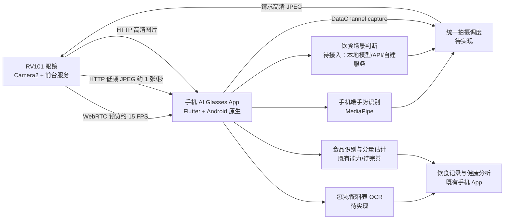

# AI 眼镜食品健康分析系统：完整技术路线与实现状态

> 本文档用于团队协作和后续开发交接。
> 内容区分“当前已实现”和“已设计但尚未实现”，避免把规划功能误认为现有能力。
> 当前代码基线：`codex/organize-aiglasses-monorepo`

## 1. 项目目标

### 1.1 竞赛材料表述版：六层端—机—云协同技术路线

本项目面向 AI 眼镜在食品健康信息服务中的应用需求，针对日常饮食记录依赖手动输入、复杂餐食与包装信息难以快速理解、个体化提示缺少可信闭环等问题，构建“第一视角感知—边缘预筛—任务路由—多模态解析—可信决策—多模态交互”的端—机—云协同技术路线。系统不将单次模型输出直接作为健康结论，而是通过结构化数据契约、规则引擎、置信度校验与用户确认，将视觉理解结果转化为可解释、可修正、可回看的饮食信息服务。以下内容用于竞赛材料和方案说明；各模块的真实实现状态以后文“当前已实现链路”和“已设计但尚未实现”章节为准。

#### （1）第一视角多模态感知与分级触发

Rokid Glasses RV101 作为低打扰的第一视角感知终端，采用 Android Camera2 持续获取饮食场景预览流，并通过前台服务、相机占用检测和退避重试机制保障采集稳定性。系统设计“主动触发 + 场景触发 + 手势辅助”的分级采集策略：用户可通过手机 App 按钮或明确手势触发高清抓拍；后续可由低清候选帧中的餐食场景判断补充自动触发。当前已实现手机 App 按钮和眼镜端手动触发的高清拍摄链路，MediaPipe 手势识别已能向手机端提供状态输入；场景自动触发和完整进餐状态机属于后续迭代能力。

#### （2）边缘预筛与端机协同传输

系统采用“低清高频感知、高清按需采集”的分层传输机制：眼镜端通过 WebRTC 向手机端提供约 15 FPS 的实时预览，同时以约 1 张/秒的低频 JPEG 作为手势识别和场景筛选候选；当拍摄调度器确认任务后，手机端经 DataChannel 向眼镜端下发高清抓拍指令，眼镜优先生成最高 4032×3024 的 JPEG 并通过局域网 HTTP 上传。图像在手机端先完成本地缓存、方向处理和状态关联，再按需要进入后续解析服务。后续将在手机端补充基于清晰度、亮度、主体范围、结构相似度（SSIM）和触发冷却时间的预筛与去重机制，减少模糊帧、重复帧和无关场景进入高成本分析流程。

#### （3）意图感知任务路由与双通道解析

系统不把所有图像送入同一识别流程，而是结合触发来源、场景标签和图像内容完成任务路由。餐食图像进入“食品理解—份量估计—营养映射”通道；包装正面、配料表和营养成分表由 OK 手势或 App 明确触发后进入“文字检测—OCR—字段抽取”通道。后续可叠加轻量级图像类型判别作为兜底校验：当画面中文字区域占比高、版面结构规则时优先路由至 OCR；当检测到餐盘、碗、食物主体等特征时优先进入食品分析。该“显式意图优先、视觉判别补充”的机制可降低货架、广告图和复杂背景造成的错误任务分发。

#### （4）食品视觉语义理解与包装文本结构化

在食品分析通道中，系统以高清餐食图像为输入，复用并持续完善既有手机端单张 AI 识图能力；后续可采用端云协同的多模态视觉模型，对开放词汇下的复杂菜品、主要食材和可能份量进行语义理解。针对单目摄像头无法直接获得深度信息的限制，项目拟采用“标准餐具/包装物尺度先验 + 手部关键点辅助参照 + 用户修正”的分层估算方式，输出以区间和置信度为核心的份量信息，而不将结果表述为精确称重。

在包装分析通道中，系统对高清图像进行旋转、裁剪、放大、对比度增强和必要的透视校正，再通过 OCR 提取配料表、营养成分表、产品名称与规格等文本；随后将非结构化文本映射为统一 JSON 字段，包括能量、蛋白质、脂肪、碳水化合物、钠、糖及过敏原等。OCR 服务封装、字段解析和包装风险识别目前仍在开发规划中，正式写入饮食记录前必须由用户确认。

#### （5）结构化数据契约、规则引擎与不确定性校验

系统以标准化 JSON 作为视觉模型、OCR、营养计算、健康分析和 App 界面之间的数据契约，至少携带食品或包装类型、识别结果、触发来源、时间戳、场景标签、置信度及必要的证据元数据。营养素、过敏原和用户主动设置的健康目标由规则层进行确定性匹配；自然语言模型仅承担结构化结果的解释与表达，不直接生成诊断、治疗或处方结论。

对于低置信度、图像质量不达标、字段缺失或数值明显偏离常识的结果，系统进入人机协同校验流程：提示用户在 App 中查看、选择、修改或删除结果，并在后续版本中支持眼镜端发起简短语音核实。用户修正后的信息将作为当前记录的最终依据，并可沉淀为后续模型评估和体验优化所需的纠错样本。图中“置信度阈值”仅作为可调校验参数，应以真实场景测试结果动态确定，而非固定承诺某一准确率。

#### （6）语音与 App 协同的多模态交互闭环

交互层由 AI 眼镜的低打扰语音反馈与手机 App 的可视化管理共同构成。眼镜端当前已具备拍照、上传成功和失败等固定语音提示能力；后续将把规则引擎输出的高优先级提醒转化为简短 TTS 播报，例如提示用户确认不确定的餐食类别、注意已主动设置的过敏原或查看包装营养字段。语音交互以“系统主动提示、用户按需确认”为原则，避免在用餐过程中要求连续口头操作，也不以语音播报替代用户的最终确认。

手机 App 是系统的控制与管理中心，承担眼镜发现与连接、实时预览、抓拍调度、识别结果展示、人工修正、饮食记录、日历回看、健康分析和个人档案维护等任务。用户可在 App 中查看每条记录的来源和结果，维护过敏原、饮食偏好与生活方式目标，并对记录进行修改或删除。由此形成“眼镜感知与即时提示 + 手机可视化确认与长期管理”的双终端闭环，在降低记录负担的同时保留用户的数据控制权。

### 1.2 总体闭环

系统最终形成以下闭环：

```text
RV101 AI 眼镜第一视角采集
  -> 手机端接收和预览
  -> 手势/场景判断
  -> 按条件触发高清拍摄
  -> 手机端食品识别、分量估计或包装 OCR
  -> 热量和营养分析
  -> 用户确认
  -> 写入既有饮食健康管理 App
  -> 首页、日历、健康分析和档案页面展示
```

当前主线是“手机主控 + 眼镜采集”：

- RV101 负责 Camera2 采集、实时传输和执行拍照；
- 手机 App 负责发现和控制眼镜、接收图片、运行判断逻辑和承载健康管理功能；
- Rokid AI 继续负责官方蓝牙配对、设备管理和系统能力；
- 自制 App 的视频和图片链路走同一 Wi-Fi 或手机热点，不走蓝牙传输视频。

## 2. 总体架构



## 3. 双端职责

### 3.1 RV101 眼镜端：采集和传输终端

当前和计划中的职责：

- 使用 Android Camera2 获取第一视角预览；
- 运行前台相机服务，降低熄屏和后台限制带来的中断；
- 维护相机占用检测、相机错误和自动重试；
- 提供局域网 `8088` 控制服务；
- 通过 WebRTC 将预览画面推送到手机；
- 每秒左右向手机发送低清候选 JPEG；
- 接收手机高清拍摄指令；
- 优先拍摄高分辨率 JPEG，失败时保留预览帧降级；
- 将高清图片和 metadata 上传到手机；
- 播放固定语音提示，如拍照、上传成功和上传失败。

眼镜端暂不负责：

- 食品场景分类；
- 食品识别；
- OCR；
- 分量、热量和营养计算；
- 复杂手势和业务状态决策。

### 3.2 手机端：主控、分析和健康管理中心

当前和计划中的职责：

- 启动本地 HTTP 接收服务；
- 计算本机局域网地址并生成上传/信令地址；
- 扫描并控制 RV101；
- 接收 WebRTC offer 并返回 answer；
- 渲染实时视频；
- 接收低清候选帧；
- 运行手势识别和饮食场景判断；
- 统一管理手势、按钮和自动拍摄任务；
- 接收高清图并接入原有 AI 食品分析；
- 运行包装 OCR 和结构化解析；
- 展示结果并在用户确认后写入饮食记录。

## 4. 当前已实现链路

### 4.1 眼镜端 Camera2 采集

已实现：


- 预览输出：`YUV_420_888`；
- 预览目标尺寸：`640x480`；
- 使用 `ImageReader` 接收最新帧；
- 预览帧同时供 WebRTC 和低频 JPEG 上报；
- 独立 JPEG reader 用于高清抓拍；
- 高清分辨率优先级：`4032x3024`，其次 `1920x1080`；
- JPEG 拍摄质量为 `95`；
- 高分辨率拍摄超时或失败时可保存预览帧兜底；
- 相机不可用或被其他系统服务占用时，按退避时间自动重试。

主要代码：

```text
glasses-app/app/src/main/java/com/example/rv101cameraprobe/CameraCaptureController.kt
glasses-app/app/src/main/java/com/example/rv101cameraprobe/CaptureService.kt
```

### 4.2 眼镜端前台服务和熄屏采集

已实现：

- `FOREGROUND_SERVICE`；
- `FOREGROUND_SERVICE_CAMERA`；
- `WAKE_LOCK`；
- 前台通知；
- `PARTIAL_WAKE_LOCK`；
- 用户启动后持续采集；
- 采集服务状态和错误状态展示；
- 基于 `BootStartReceiver`/待机服务的辅助恢复机制。

限制：

- RV101 固件可能阻止第三方 App 冷启动；
- 眼镜完整重启、重新安装或进程被系统杀掉后，通常需要先打开一次眼镜端 App；
- 前台服务不能保证 Rokid 系统相机服务永远不抢占相机。

### 4.3 眼镜端局域网控制服务

眼镜监听：

```text
TCP 8088
```

主要接口：

```text
GET  /api/v1/glasses/status
POST /api/v1/glasses/start
```

手机发送启动请求时携带：

```json
{
  "uploadEndpoint": "http://<手机IP>:8080/api/v1/captures",
  "token": "<配对令牌>"
}
```

眼镜保存地址和令牌，然后启动 Camera2、WebRTC 和低频帧上报。

### 4.4 WebRTC 实时预览

已实现：

1. 眼镜端创建 PeerConnection；
2. 创建视频轨道和控制 DataChannel；
3. Camera2 YUV 帧转换为 I420；
4. 眼镜端创建 offer；
5. POST 到手机的 `/api/v1/webrtc/offer`；
6. 手机端创建 answer 并返回；
7. 手机端通过 `RTCVideoRenderer` 显示视频；
8. 通过 ICE 状态和统计信息显示连接状态。

当前参数：

```text
目标帧率：约 15 FPS
帧间隔：约 66 ms
视频方向：默认旋转 270 度
网络：同一 Wi-Fi/手机热点
STUN/TURN：未配置
```

这不是公网直播方案，也不依赖蓝牙传输视频。

### 4.5 低频候选帧上报

已实现：

```text
POST http://<手机IP>:8080/api/v1/scene/frames
X-Device-Token: <配对令牌>
Content-Type: multipart/form-data
```

字段：

```text
image: JPEG
metadata: JSON
```

当前真实参数：

```text
Camera2 原始预览：640x480 YUV_420_888
旋转：270 度
JPEG 质量：58
上报间隔：最多每 1000 ms 一张
手机端单张候选图限制：2 MB
```

当前低频帧主要用于手机端 MediaPipe 手势识别。后续可将同一输入交给本地模型、豆包 API 或自建视觉服务。

### 4.6 高清拍摄和上传

已实现：

- 手机端通过 DataChannel 发送：

```json
{
  "type": "capture",
  "trigger": "app_button",
  "timestamp": 1786400000000
}
```

- 眼镜端接收后调用 Camera2 高清 JPEG 拍摄；
- 上传接口：

```text
POST http://<手机IP>:8080/api/v1/captures
X-Device-Token: <配对令牌>
Content-Type: multipart/form-data
```

- 表单包含 `image` 和 `metadata`；
- 手机端保存到 App 私有目录；
- 手机页面显示最新图片；
- 图片可以进入原有单张 AI 识图流程；
- 上传失败时眼镜保留本地图片并提示失败。

当前已支持的主要触发来源：

```text
app_button：手机 App 按钮
manual：眼镜端手动/调试触发
```

### 4.7 手机端手势识别

已实现 MediaPipe Hand Landmarker：

- Android 原生层加载 `hand_landmarker.task`；
- CPU Delegate；
- `IMAGE` 模式；
- 最多检测两只手；
- 通过关键点规则判断手势；
- 手机端 Flutter 通过 MethodChannel 获取结果。

当前规则：

| 手势 | 当前状态 |
|---|---|
| OK | `ingredient_label`，配料表识别模式提示 |
| 张开手掌 | `eating`，进餐环境提示 |
| 其他 | `unknown`，等待状态 |

当前手势识别只更新手机页面状态，不会自动触发高清拍摄。

### 4.8 既有手机健康管理 App

已存在并保留：

- 首页：当日饮食概况、热量和营养素；
- 日历：历史摄入和营养总结；
- 识别：相册、手机拍照和眼镜抓拍进入同一识图入口；
- 健康分析：结合用户档案和历史数据给出分析；
- 档案：基本信息、疾病史、过敏原和饮食偏好。

当前新增的眼镜链路已经可以把高清 JPEG 送入原有识图入口，但复杂的餐前/餐后对比、OCR 自动触发和自动饮食记录仍未完成。

## 5. 已设计但尚未实现的采集逻辑

### 5.1 三种采集模式

计划支持：

#### 手动模式

用户通过 App 按钮或明确手势触发高清拍照，适合：

- 包装正面；
- 配料表；
- 营养成分表；
- 用户临时想记录的食物。

#### 自动模式

低清候选帧交给场景分类模块。自动模式不要求先进入 `EATING` 状态：

```text
IDLE
  -> 连续检测到适合记录的餐食场景
  -> 延迟
  -> 拍摄 meal_before
  -> 进入 EATING
```

在 `EATING` 期间，满足冷却和质量条件的餐食场景可触发 `meal_during`。

#### 混合模式

同时允许自动判断和用户手势：

- 用户明确手势优先；
- 自动场景判断作为补充；
- 包装和配料表仍要求 OK 手势或 App 按钮明确触发；
- 自动模式不自动拍摄货架和包装，减少误拍。

### 5.2 统一拍摄调度器

计划新增手机端 `CaptureCoordinator`，所有高清拍摄任务统一进入调度器：

```text
手势任务 / App 按钮 / 自动场景任务
                  ↓
          CaptureCoordinator
                  ↓
       延迟、优先级、冷却、去重
                  ↓
       DataChannel capture 指令
```

计划规则：

- 同时只允许一张高清拍摄任务；
- 明确用户手势优先于自动任务；
- 默认触发后等待 `2-3 秒`；
- 自动拍摄默认冷却 `8-10 秒`；
- 图片质量不合格最多重拍 `2 次`；
- 拍摄中或冷却期间的低优先级自动任务直接跳过；
- 每张图片写入触发来源和场景标签。

### 5.3 进餐状态机

计划状态：

```text
IDLE
  -> 张开手掌确认
  -> meal_before
  -> EATING
  -> meal_during（可选）
  -> 握拳确认
  -> meal_after
  -> IDLE
```

具体设计：

- 张开手掌连续识别 `2-3` 帧，进入开始进食流程；
- 延迟 `2-3 秒`后拍摄餐前图；
- 进食中由场景分类决定是否补拍餐食图；
- 握拳连续识别 `2-3` 帧，取消未执行自动任务；
- 延迟后拍摄餐后剩余食物图；
- 如果没有握拳，只能把某时段最后一张有效餐食图标记为 `meal_after_candidate`，交给用户确认，不能直接认定吃完饭。

计划 metadata：

```json
{
  "mealSessionId": "generated-id",
  "trigger": "open_palm|auto_food_scene|fist|ok_gesture|app_button",
  "scene": "meal_before|meal_during|meal_after|meal_after_candidate|ingredient_label"
}
```

### 5.4 握拳识别

当前未实现。计划在手机端 MediaPipe 关键点规则中新增 `isFistGesture()`，并要求连续多帧确认，以减少误触发。

## 6. 已设计但尚未实现的场景分类

### 6.1 分类目标

当前已讨论的目标不是简单的“有没有食物”，而是判断是否适合饮食记录：

```text
meal_scene：餐盘、碗、桌面饭菜，主体清晰，适合分量记录
food_non_meal：包装、货架、手持零食、广告或美食图片
invalid_scene：人物、手部、地面、空桌、远景、模糊或无关画面
```

也可以先做二分类或直接调用通用视觉 API，具体实现开放给负责同学。手机端接口只固定输入图片和返回标签/置信度，不强制 TFLite。

### 6.2 分类输入

分类模块接收：

- 单张 JPEG；
- 来自 `POST /api/v1/scene/frames` 的 `image` 字段；
- 原始预览约 `640x480`，旋转后通常约 `480x640`；
- 眼镜最多每秒上传一张；
- 使用云端 API 时建议每 `3-5 秒`处理手机侧保留的最新一张，避免费用和请求堆积。

### 6.3 自动拍摄判定

计划组合判断：

```text
meal_scene
+ 置信度达到阈值
+ 连续命中至少 2 次
+ 当前模式允许自动拍摄
+ 图片清晰、主体未脱离画面
+ 与最近照片不重复
+ 不在冷却期
=> 请求高清 JPEG
```

### 6.4 可选实现方案

负责同学可自行选择：

1. 手机端本地轻量模型；
2. 豆包或其他视觉 API；
3. 自建后端部署通用视觉模型；
4. 先用 API 验证，再替换为本地模型。

建议分工：低清高频帧由轻量模型或限频 API 负责筛选；高清图片再交给复杂视觉模型进行食品识别、分量估计和营养分析。

## 7. 包装与配料表 OCR

### 7.1 触发方式

包装和配料表不由自动场景分类直接触发，避免货架、广告和无关商品误拍：

```text
OK 手势或 App 按钮
  -> 延迟等待手离开
  -> 高清 JPEG
  -> OCR
  -> 字段解析
  -> 用户确认
```

### 7.2 计划实现内容

需要新增：

- OCR 服务封装；
- 图片旋转、裁剪、放大、亮度/对比度和透视校正；
- 原始 OCR 文本展示；
- 配料表提取；
- 营养成分提取：能量、蛋白质、脂肪、碳水化合物、钠；
- 过敏原和高糖/高脂/高钠风险识别；
- 字段缺失和低置信度提示；
- 用户修改和确认页面。

结果示例：

```json
{
  "ingredients": ["小麦粉", "白砂糖", "植物油"],
  "energyKj": 1850,
  "proteinG": 6.2,
  "fatG": 18.5,
  "carbohydrateG": 62.4,
  "sodiumMg": 420,
  "ocrConfidence": 0.86
}
```

OCR 结果不能直接等价为用户已经摄入该食品，必须经过用户确认后再写入食品详情或饮食记录。

## 8. 食品识别、分量估计和健康分析

### 8.1 现有能力

手机端已经有原有单张图片 AI 识图和健康管理页面，眼镜高清图可以复用该入口。

### 8.2 计划扩展

餐食图片：

```text
meal_before / meal_during / meal_after
  -> 食物类别识别
  -> 分量估计
  -> 热量和三大营养素估计
  -> 对比餐前餐后变化
  -> 用户确认
  -> 写入饮食记录
```

包装图片：

```text
ingredient_label
  -> OCR
  -> 结构化营养字段
  -> 过敏原和风险提示
  -> 用户确认保存
```

餐前餐后图片只能提供粗略摄入量估计，无法保证精确测量。若食物被完全吃完或视角发生变化，系统只能给出区间或提示用户修正。

## 9. 数据与服务协议

### 9.1 低清候选帧

```text
POST /api/v1/scene/frames
X-Device-Token: <token>
multipart/form-data
  image: JPEG
  metadata: JSON
```

用途：手势识别、饮食场景判断和自动拍摄候选筛选。不作为正式饮食记录图片保存。

### 9.2 高清抓拍

```text
POST /api/v1/captures
X-Device-Token: <token>
multipart/form-data
  image: JPEG
  metadata: JSON
```

用途：食品识别、OCR、分量分析和用户确认后的饮食记录。

### 9.3 WebRTC 信令

```text
POST /api/v1/webrtc/offer
X-Device-Token: <token>
Content-Type: application/json
```

用途：建立眼镜到手机的实时预览连接，不承载正式图片保存。

## 10. 日常运行流程

### 10.1 当前已可运行流程

```text
1. 手机和 RV101 连接同一 Wi-Fi 或手机热点
2. 眼镜端首次启动时打开 RV101 Camera Probe
3. 手机 App 进入“识别 -> 实时预览”
4. 手机监听 8080 并扫描眼镜 8088
5. 手机下发上传地址和 token
6. 眼镜启动 Camera2、WebRTC 和候选帧上报
7. 手机显示实时预览
8. 手机按钮发送 capture
9. 眼镜拍摄高清 JPEG 并上传
10. 手机显示图片并进入原有 AI 识图入口
```

### 10.2 计划中的目标流程

```text
手动模式：App/OK -> 高清拍摄 -> OCR 或食品分析

自动模式：低清候选帧 -> 场景判断 -> meal_before/meal_during 高清拍摄

混合模式：张手开始 -> meal_before
         -> 场景判断补拍 meal_during
         -> 握拳结束 -> meal_after
```

## 11. 当前未完成事项

明确未实现：

- 握拳手势识别；
- 三模式切换页面；
- `CaptureCoordinator` 统一调度器；
- IDLE 状态下由 `meal_scene` 自动触发 `meal_before`；
- EATING 状态下自动拍摄 `meal_during`；
- `meal_after` 和 `meal_after_candidate` 流程；
- 场景分类模型或云端 API 的正式接入；
- 图片清晰度、主体范围和重复度判断；
- 自动重拍和自动拍摄冷却；
- 包装 OCR 服务和结构化解析；
- 餐前餐后分量差异计算；
- 手机后台长期接收服务和离线上传队列；
- 手机/眼镜双端上传任务状态和重试去重；
- 全链路真机稳定性测试和答辩演示脚本。

## 12. 推荐开发顺序

### 阶段一：不依赖场景模型的可演示闭环

1. 新增握拳识别；
2. 实现三模式页面和 `CaptureCoordinator`；
3. 张开手掌后延迟拍 `meal_before`；
4. 握拳后延迟拍 `meal_after`；
5. OK 手势拍摄包装图片；
6. 接入 OCR 原始文本和结构化字段；
7. 用按钮/手势验证全部拍摄链路。

### 阶段二：接入饮食场景判断

1. 赵同学确定本地模型、豆包 API 或自建视觉服务；
2. 按本文档接收单张 JPEG 候选帧；
3. 先使用 `3-5 秒`限频调用或本地推理；
4. 连续场景命中后触发 `meal_before` 和 `meal_during`；
5. 增加清晰度、主体范围、重复度和冷却策略。

### 阶段三：接入食品健康分析

1. 接入食品识别；
2. 接入分量估计；
3. 计算热量和营养素；
4. 加入餐前餐后对比；
5. OCR 结果进入食品详情；
6. 用户确认后写入健康管理 App。

### 阶段四：稳定性和产品化

1. 手机端前台接收服务；
2. 眼镜离线待上传队列；
3. 网络恢复自动重试；
4. `captureId` 去重；
5. 相机被系统占用的可视化提示；
6. 热点和普通 Wi-Fi 双网络回归测试；
7. 记录延迟、误拍、漏拍、上传失败和耗电情况。

## 13. 协作和安全要求

- ADB 命令必须使用 `-s` 指定设备；
- 手机 APK 和眼镜 APK 必须分别安装到对应设备；
- 不提交真实图片、热点密码、API Key、Token 和 `local.properties`；
- 不把云端 API Key 写入手机 APK 或眼镜 APK；
- 修改接口、图片方向、分辨率、JPEG 质量或上报间隔时同步文档；
- 修改相机链路后回归 WebRTC、低频候选帧和高清抓拍三条链路；
- 自动分析结果必须经过用户确认后写入正式健康记录。

## 14. 关键代码位置

眼镜端：

```text
glasses-app/app/src/main/java/com/example/rv101cameraprobe/CameraCaptureController.kt
glasses-app/app/src/main/java/com/example/rv101cameraprobe/CaptureService.kt
glasses-app/app/src/main/java/com/example/rv101cameraprobe/GlassesControlServer.kt
glasses-app/app/src/main/java/com/example/rv101cameraprobe/WebRtcPreviewPublisher.kt
glasses-app/app/src/main/java/com/example/rv101cameraprobe/PreviewFrameReporter.kt
glasses-app/app/src/main/java/com/example/rv101cameraprobe/PhotoUploader.kt
glasses-app/app/src/main/java/com/example/rv101cameraprobe/YuvFrameConverter.kt
```

手机端：

```text
phone-app/lib/recognition_page_fast.dart
phone-app/lib/services/glass_receiver_service.dart
phone-app/lib/services/phone_scene_classifier.dart
phone-app/android/app/src/main/kotlin/com/aiglasses/nutrition/MainActivity.kt
phone-app/android/app/src/main/kotlin/com/aiglasses/nutrition/PhoneSceneClassifier.kt
phone-app/android/app/src/main/assets/hand_landmarker.task
```

## 15. 一句话总结

当前项目已经完成“RV101 Camera2 采集 -> 手机局域网 WebRTC 预览/HTTP 图片接收 -> 手机手势识别 -> 高清抓拍 -> 原健康 App 识图”的基础链路；下一阶段将在手机端加入三模式拍摄调度、握拳餐后触发、饮食场景判断、包装 OCR、餐前餐后分析和自动化可靠性机制。
